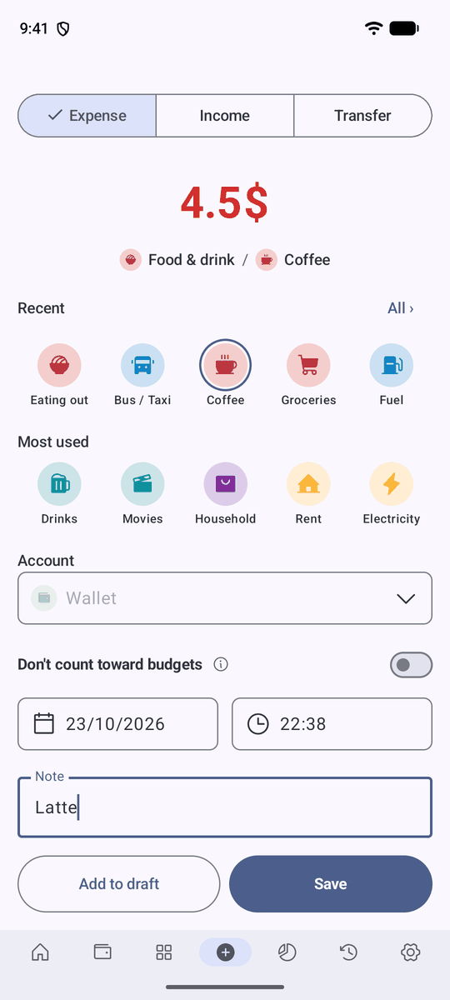
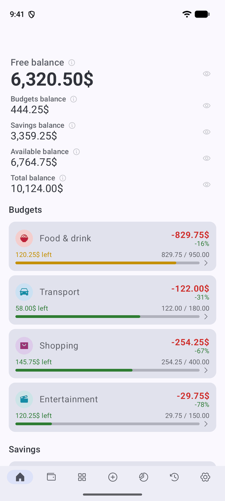
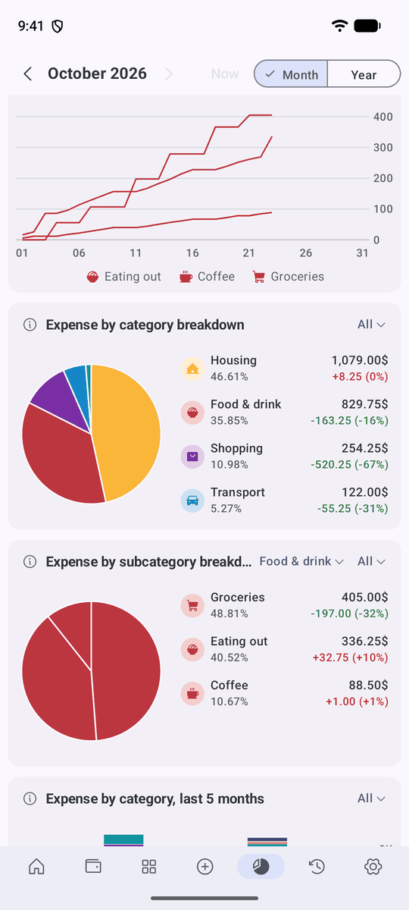
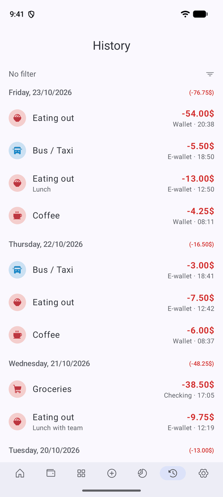
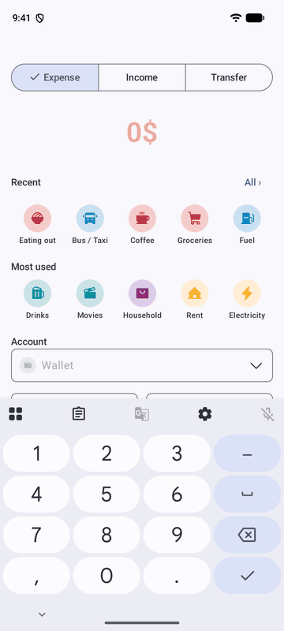
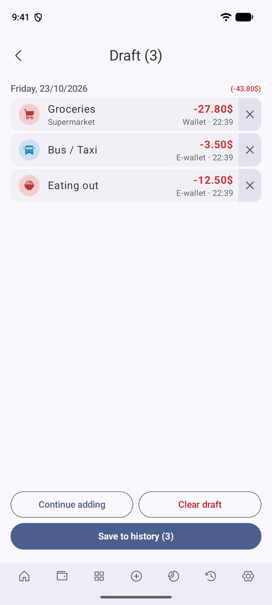
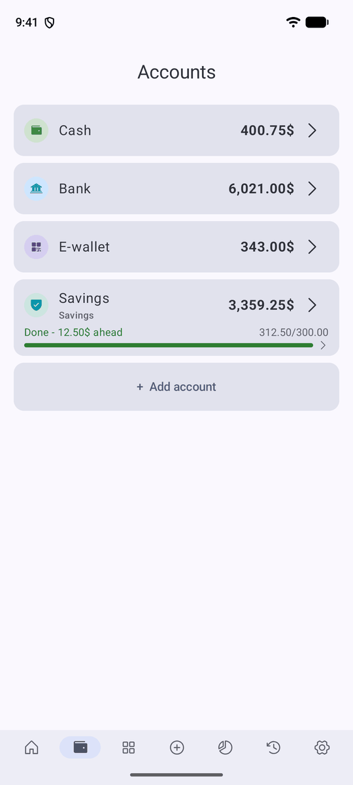
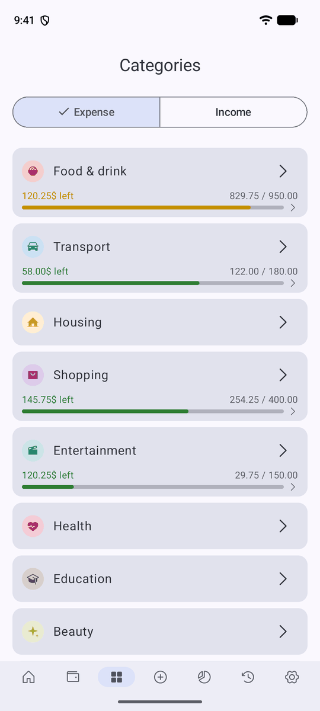
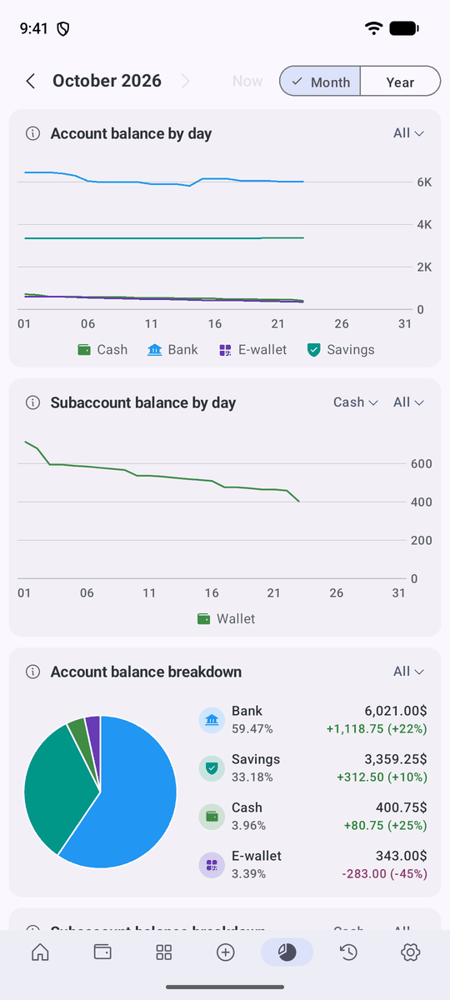

<div align="center">

# Outgo

**A small, fast, offline expense tracker for Android.**

Open the app and you are already on the "add expense" screen.<br>
Type the amount, tap a category, save. That's it.

[](https://github.com/ngth1010v/Outgo/releases/latest)
[](LICENSE)


&nbsp;
&nbsp;
&nbsp;


**[⬇ Download the latest APK](https://github.com/ngth1010v/Outgo/releases/latest)**

</div>

## Why Outgo

- **Built for logging fast.** The app opens on the add screen, so a purchase takes a few taps.
- **Private.** No account, no network, no ads. Your data stays on your phone.
- **One file holds everything.** Back up and restore with a single `.sqlite` file.
- **Light.** About 4 MB, starts quickly, and stays smooth on older phones.
- **English and Vietnamese.**

## Features

### Quick entry



- **Expense, Income and Transfer** share one form. Swipe left or right to switch.
- **Smart category grid:** one row shows your 5 most recent categories, one row your 5 most used. Most entries need one tap. **All ›** opens the full list, which you can search.
- **Predictions:** empty fields are guessed from your past transactions and shown faded. Tap a field to clear its guess. You can turn this off or set how sure a guess must be.
- Pick the account, date, time and an optional note. After **Save** the form resets, and a snackbar offers **Undo**. Swipe the snackbar away to dismiss it.
- The amount cursor goes where you tap, so you can fix one digit in the middle of a number.

<br clear="right" />

### Draft list



Back from a trip with a stack of receipts? Collect them first, save them together.

- Tap **Add to draft** instead of **Save**. While the draft has items, the buttons become **Add to draft** and **Draft (n) ›**, so nothing goes to History by accident.
- Expenses, incomes and transfers can be mixed.
- In the list: tap a row to edit it, **x** to remove it, **Clear draft**, or **Save to history** to save everything at once.
- Drafts that point to a deleted or archived account or category are flagged and stay in the list.
- The draft lives in memory only. It is gone when the app is closed.

<br clear="right" />

### Home


- **Free, budgets, savings, available and total balance** at a glance. Tap the ⓘ next to one to see how it is calculated, or the eye to hide it.
- **Budgets** for this month: amount spent, left or over, and the change against last month. A warning shows when your available money can't cover what your budgets still need.
- **Savings** progress toward each savings account's monthly target.
- Tap a budget or savings bar to open its **pace panel**: what is left per remaining day, and this month's running total against a straight line to the limit or target. The gap is shaded green when you are on track and red when you are not.

<br clear="right" />

### Accounts and savings



- Several accounts, for example cash, bank and e-wallet, each with its own icon and color, and subaccounts inside them.
- **Savings accounts** can have a monthly target. A progress bar tracks it and turns green when you reach it.
- Edit a balance directly. Outgo records the difference as a balance adjustment, so the balance always matches the history. A new account's first balance is its opening balance, dated the day you choose.
- Accounts with history are archived, not deleted, so past records stay correct.
- **Drag to reorder:** long-press an account, drag it, let go. The order is used everywhere.

<br clear="right" />

### Categories and budgets



- **Two-level categories** (category and subcategory) for expense and income. A default set is created on first launch.
- A **monthly budget** on any expense category. A category's budget counts the spending of all its subcategories.
- The bar shows what is left. It turns red, with the amount over, when you go past the budget.
- **253 built-in icons**, grouped by theme in the picker, or **import your own PNG**. Imported icons are stored in the database, so backups include them.
- **Drag to reorder:** long-press a category or subcategory, drag it, let go. Hold a subcategory over a folded category for a moment and it opens, so you can move the subcategory into it. Its past transactions and budget spending move with it.

<br clear="right" />

### Analysis

<p>
  &nbsp;
  
</p>

- **One page per month and one per year.** Swipe between them, or jump with the pickers in the top bar. Swipe right off December to reach that year's page.
- **Your own layout:** a page is a list of chart cards you arrange. Long-press a card to drag it. Drag it to the right edge to remove it (with **Undo**). **Add chart** at the bottom offers every chart, grouped and with icons. The layout is saved in the database, so it travels with backups.
- **Accounts:** balance by day, balance breakdown and the last 5 months, for all accounts or the subaccounts of one.
- **Categories:** the same charts for expense and income, by category or by the subcategories of one category, in money or in number of transactions.
- **Transactions:** a day calendar, weekday and time of day, transaction sizes, the largest transactions, transfer flows.
- **Savings and budgets:** pace, month forecast, burn-down, savings rate, and the last months' targets and limits.
- **Month summary:** total, change against last month, average per day, and money moved between accounts.

### History


- Every transaction, grouped by day, with daily totals.
- Filter by type, account, category, date range, amount or note text.
- Tap a transaction to edit or delete it.

<br clear="right" />

### Settings and data

- **Language:** English or Vietnamese, or follow the system.
- **Currency:** 20 common symbols, or type your own. Choose the **number format** (for example `1,234.56` or `1.234,56`) and **0, 1 or 2 decimal places**.
- **Backup and restore to one `.sqlite` file.** It holds everything: accounts, categories, transactions, budgets, settings and imported icons. A restore first keeps a safety copy of your current data on the device.

## Download

1. Go to the [Releases page](https://github.com/ngth1010v/Outgo/releases/latest).
2. Download `Outgo.apk` from the latest release.
3. Open the file on your phone to install it. The first time, Android asks for permission to install apps from this source. Allow it, then tap **Install**.
4. Open **Outgo** from your app drawer.

Requires Android 11 (API 30) or newer. New versions install over the old one and keep your data.

> **Updating from v1.5.1 or older?** Starting with v1.6.0, releases are signed with a new key, so Android will not install them over an older version. First export a backup in **Settings → Export backup**. Then uninstall the old app, install the new one, and use **Settings → Restore from backup**.

## Build from source

Requirements: JDK 17+ and the Android SDK (`ANDROID_HOME` or `local.properties`).

```bash
build.bat            # debug APK   -> app\build\outputs\apk\debug\app-debug.apk
build.bat release    # release APK (R8 minified; needs a signing config, see below)
build.bat clean      # clean, then debug APK
```

Or run Gradle directly: `gradlew.bat assembleDebug`, `gradlew.bat assembleRelease`.

### Release signing

`build.bat release` signs with the keystore named by `keystore.properties`. Both that file and the
`keystore/` directory are gitignored: a signing key in a public repository lets anyone build an APK
that Android installs straight over yours as an update. Without them the build still succeeds, but
the APK is unsigned and will not install.

Create your own once:

```bash
keytool -genkeypair -v -keystore keystore/outgo-release.jks -alias outgo \
        -keyalg RSA -keysize 4096 -validity 10000
```

Then write `keystore.properties` in the repository root (`storeFile` is resolved from there):

```properties
storeFile=keystore/outgo-release.jks
storePassword=…
keyAlias=outgo
keyPassword=…
```

Keep that keystore backed up somewhere private. Losing it means existing installs can never be
updated: they have to be uninstalled first, and Outgo keeps its data on the device only. For CI,
hold the keystore as a base64 secret and write both files during the job rather than committing
them. For Google Play, enrol in Play App Signing and keep this key as the private *upload* key.

Check what a build produced:

```bash
apksigner verify --verbose app\build\outputs\apk\release\app-release.apk
```

## Under the hood

- **Kotlin, Jetpack Compose and Material 3.** A single-activity app with no DI framework and no image-loading library.
- **One SQLite file (Room).** Money is stored as `Long` in hundredths of the currency unit, never as floating point. SQL triggers keep balances, monthly category totals and category usage counts up to date.
- **Fast cold start.** The first frame draws before the database opens. A committed **Baseline Profile** compiles the startup path and every animated transition ahead of time.

See [architecture.md](architecture.md) for the full design (in Vietnamese): data model, triggers, screens, backup format and performance budget.

## License

[MIT](LICENSE) © ngth1010v. Navigation and UI icons are based on [Phosphor Icons](https://phosphoricons.com) (MIT). Part of the category icons come from [Tabler Icons](https://tabler.io/icons) (MIT).
